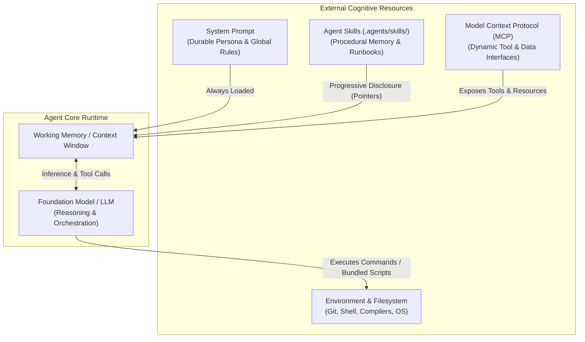
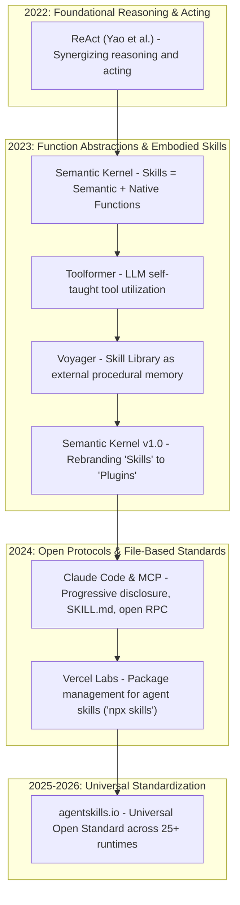
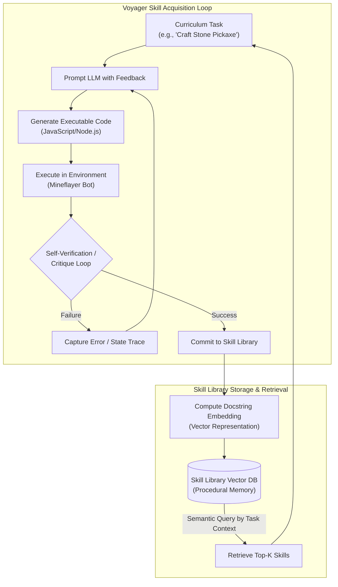
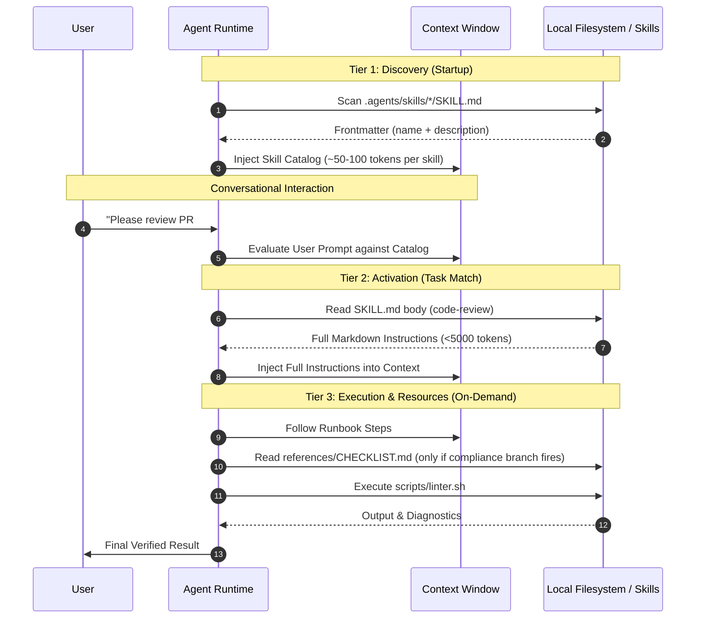
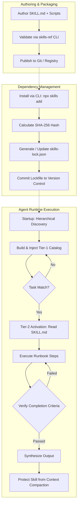
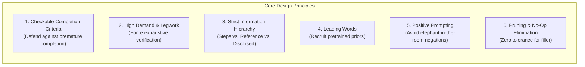

# Technical Investigation: Agent Skills Architecture, Specifications, Mechanics, and Ecosystem

This report presents an exhaustive, primary-source technical investigation into the **Agent Skills** paradigm across modern artificial intelligence architectures. It examines the formal specifications, cognitive underpinnings, runtime mechanics, context economics, and open-source ecosystem implementations that govern how modern autonomous agents acquire, manage, and execute specialized procedural capabilities.

Every architectural claim, schema definition, lifecycle state, and configuration standard documented below is sourced directly from primary specifications, foundational academic literature, official framework documentation, and authoritative reference repositories:
- **Open Standard Specification**: [agentskills.io/specification](https://agentskills.io/specification)
- **Agent Skills Documentation & Client Showcase**: [agentskills.io](https://agentskills.io)
- **Official Specification Repository**: [github.com/agentskills/agentskills](https://github.com/agentskills/agentskills)
- **Anthropic Claude Code Skills Architecture**: [code.claude.com/docs/en/skills](https://code.claude.com/docs/en/skills) & [platform.claude.com](https://platform.claude.com/docs/en/agents-and-tools/agent-skills/overview)
- **Google Antigravity (AGY) Customization System**: Antigravity Customization Reference (`agy-customizations`) & built-in runtime schemas
- **Microsoft Semantic Kernel Architecture**: [learn.microsoft.com/semantic-kernel](https://learn.microsoft.com/en-us/semantic-kernel/) (from early Semantic/Native Functions to Plugins)
- **Academic Foundational Literature**: *Voyager: An Open-Ended Embodied Agent with Large Language Models* (Wang et al., 2023, arXiv:2305.16291)
- **Agent Skills Packaging & Lockfile Standard**: [github.com/vercel-labs/skills](https://github.com/vercel-labs/skills) & [github.com/mattpocock/skills](https://github.com/mattpocock/skills) (`skills-lock.json`)
- **Repository Foundations**: `.agents/skills/writing-for-agents/SKILL.md` & `SKILL-MECHANICS.md`

---

## 1. Formal Definition & Conceptual Boundaries

### 1.1 What is an Agent Skill?
An **Agent Skill** is a self-contained, modular package of procedural instructions, domain knowledge, executable scripts, and referenced assets designed to extend an AI agent's capabilities on demand. Formatted natively as a directory containing a mandatory `SKILL.md` instruction file governed by structured YAML frontmatter, an Agent Skill encapsulates a repeatable, verifiable workflow that guides an agent through a multi-step task.

From a cognitive architecture perspective, an Agent Skill represents externalized **procedural memory** (the *know-how* to perform specific tasks) as opposed to **declarative memory** (raw facts and knowledge stored in model weights or retrieved via RAG). By decoupling an agent’s foundational reasoning engine (the LLM) from domain-specific runbooks, skills enable agents to execute intricate technical tasks—such as code refactoring, schema migrations, vulnerability audits, and test generation—with high determinism, reduced variance, and strict alignment to human workflows.



### 1.2 Boundary Distinctions
A frequent source of architectural confusion is distinguishing Agent Skills from adjacent AI paradigms. The table below delineates the strict technical boundaries separating skills from system prompts, tools (and MCP servers), workflows, and standalone scripts:

| Concept | Primary Purpose | State & Transport | Context Footprint | Primary Failure Mode Addressed |
| :--- | :--- | :--- | :--- | :--- |
| **Agent Skill** | Procedural runbook & domain guidance | Static file bundle (`SKILL.md`, scripts, references) | **Progressive**: Metadata upfront (~100 tokens), body on demand | Behavioral variance, skipped verification steps, unaligned multi-step processes |
| **System Prompt** | Foundational identity, global guardrails, tone | Injected verbatim into every turn's request payload | **Permanent**: Consumes tokens on every conversational turn | Context saturation, instruction drift, conflicting project-level guidelines |
| **Tool / MCP Server** | Primitive execution capabilities (API, DB, PTY) | Dynamic JSON-RPC over `stdio`/`SSE` (Model Context Protocol) | Tool schema loaded in tool definition space | Inability to interact with live external environments or fetch dynamic data |
| **Workflow / DAG** | Hardcoded deterministic orchestration (e.g. LangGraph) | Programmatic control flow (state machine, graph) | Application runtime memory | Rigid, brittle execution unable to adapt to unexpected intermediate states |
| **Standalone Script** | Deterministic compute or file manipulation | Executable binary/source code (`.sh`, `.py`, `.ts`) | Zero until executed; outputs stream to terminal | Lack of cognitive orchestration; requires a human or agent to know when and how to invoke it |

### 1.3 The Complementarity of Skills and MCP (Model Context Protocol)
Agent Skills and the **Model Context Protocol (MCP)** are frequently discussed together, leading to the mistaken assumption that they are competing standards. In reality, they are **strictly complementary layers** of the modern agent stack:

- **MCP is the Muscle and Senses**: MCP provides standard client-server interfaces (tools, resources, prompts) through which an agent interacts with external services (e.g., executing a SQL query, querying the GitHub API, reading Slack channels, or managing terminal sessions). MCP gives the agent the *capability* to act upon the world.
- **Agent Skills are the Playbook and Brain**: Skills provide the *methodology* and *domain criteria*. A skill instructs the agent on *which* tools to call, in *what sequence*, under *what preconditions*, and against *what completion criteria*.

> **The Architectural Analogy**: MCP is a keycard that unlocks a secure server room; an Agent Skill is the Standard Operating Procedure (SOP) manual instructing the engineer on which maintenance commands to run, what diagnostic metrics to verify, and how to safely execute a database migration without causing downtime.

When combined, a skill's `SKILL.md` file specifies dependencies or recommended tool access via experimental fields like `allowed-tools: Bash(git:*) Read`, instructing the agent to utilize specific MCP tools or local shell commands while executing its procedural steps.

---

## 2. Historical & Academic Genealogy

The conceptual lineage of Agent Skills converges from three distinct origins: software framework design, academic artificial intelligence research, and practical developer ergonomics.



### 2.1 The Genesis of "Skills": Microsoft Semantic Kernel (2022–2023)
The terminology of "Skills" in LLM orchestration was introduced by Microsoft in the early releases of **Semantic Kernel** (late 2022 to mid-2023). In Semantic Kernel's initial architecture, a **Skill** was a container class or directory encapsulating two complementary types of functions:
1. **Semantic Functions**: Pure prompt templates expressed as natural language files (`skprompt.txt` accompanied by execution metadata in `config.json`). These allowed prompts to be parameterized and treated as first-class invocable functions.
2. **Native Functions**: Traditional procedural code written in the host language (C# or Python, marked with attributes like `[KernelFunction]`) that performed deterministic operations (database lookups, math, external HTTP requests).

In November 2023, with the release of Semantic Kernel v1.0, Microsoft rebranded "Skills" to **Plugins** to align with the emergent industry terminology established by OpenAI's ChatGPT Plugins and the OpenAPI standard. Despite the naming pivot, the fundamental paradigm—pairing natural language semantic definitions with deterministic native code execution—directly anticipated the modern Agent Skill architecture.

### 2.2 Academic Milestone: Voyager (Wang et al., May 2023)
The landmark paper ***Voyager: An Open-Ended Embodied Agent with Large Language Models*** (Wang et al., May 2023, arXiv:2305.16291, developed across MineDojo, NVIDIA, Caltech, Stanford, and UT Austin) established the definitive academic foundation for modern skill systems in LLM agents.

Voyager demonstrated an autonomous agent in the open-ended Minecraft environment that continuously acquired, refined, and retained complex capabilities without human intervention or model fine-tuning. The system rested on three pillars:
1. **An Automatic Curriculum**: Proposing progressive exploration goals based on the agent's current state.
2. **An Iterative Prompting Mechanism**: Refining executable code through environmental feedback, execution error traces, and self-verification.
3. **An Ever-Growing Skill Library**: Storing learned behaviors as executable programs.



#### Key Findings of the Voyager Skill Library:
- **Procedural Memory vs. Catastrophic Forgetting**: Traditional reinforcement learning (RL) agents suffer catastrophic forgetting when exposed to diverse multi-task distributions because weights are overwritten. By writing skills as discrete, interpretable programs stored in an external library, Voyager achieved permanent retention.
- **Hierarchical Compositionality**: High-level skills were synthesized by composing previously validated lower-level skills (e.g., `craftStonePickaxe()` internally calls `mineWood()`, `craftPlanks()`, and `craftCraftingTable()`).
- **Cross-Environment Transferability**: Voyager demonstrated that a populated skill library could be lifted from one Minecraft seed and dropped into an entirely new, unvisited world, accelerating new task resolution by orders of magnitude compared to blank-slate baselines.

### 2.3 The Evolution to Open File-Based Standards (2024–2026)
As agentic coding assistants expanded from chat sidebars into autonomous terminal agents (e.g., Anthropic Claude Code, Google Antigravity, OpenHands, Goose, Cursor), the industry moved away from opaque vector-only prompt stores toward **filesystem-native, human-readable skill directories**. 

This transition culminated in the **Agent Skills open specification** hosted at `agentskills.io`. Developed collaboratively by Anthropic, tooling creators, and the open-source community, the specification standardized the `SKILL.md` format, YAML frontmatter schemas, directory layouts, and progressive disclosure lifecycles, enabling a single skill folder to be shared seamlessly across dozens of diverse agent runtimes.

---

## 3. Architectural Anatomy & Specification Standard

According to the official Agent Skills specification (`agentskills.io/specification`), an Agent Skill must follow a deterministic directory and file structure.

### 3.1 The Directory Anatomy
At minimum, a skill consists of a directory containing a single `SKILL.md` file. Advanced skills bundle executable scripts, references, and static assets:

```text
skill-name/
├── SKILL.md          # Mandatory: YAML frontmatter + procedural instructions
├── scripts/          # Optional: Executable code (Bash, Python, Node.js)
│   ├── prepare.sh
│   └── validate.py
├── references/       # Optional: On-demand documentation, schemas, domain guides
│   ├── SPEC.md
│   └── schema.json
└── assets/           # Optional: Static boilerplate, templates, configuration fixtures
    └── template.config.yaml
```

### 3.2 YAML Frontmatter Specification
The `SKILL.md` file must open with a valid YAML frontmatter block enclosed between triple-hyphen delimiters (`---`). The schema constraints are strictly defined:

```markdown
---
name: database-migration
description: >-
  Executes relational schema migrations, generates rollback scripts, and
  validates data integrity constraints against PostgreSQL databases.
license: Apache-2.0
compatibility: Requires psql, pg_dump, and Python 3.11+
metadata:
  author: enterprise-data-team
  version: "2.1.0"
allowed-tools: Bash(psql:*) Read Edit
disable-model-invocation: false
---

# Database Migration Runbook
[Procedural Markdown content follows...]
```

#### Detailed Field Schema:
- **`name`** *(String, Required)*:
  - Length: 1 to 64 characters.
  - Allowed characters: Unicode lowercase alphanumeric (`a-z`, `0-9`) and hyphens (`-`).
  - Validation rules: Must not begin or end with a hyphen; must not contain consecutive hyphens (`--`).
  - Canonical constraint: Must match the parent directory name exactly (e.g., directory `pdf-tools/` must contain `name: pdf-tools`).
- **`description`** *(String, Required)*:
  - Length: 1 to 1024 characters. Non-empty.
  - Critical function: Acts as the **top-level context pointer**. The agent reads this description during initial session discovery to decide whether the skill matches the current user request.
  - Formulation: Must describe both *what* the skill does and the specific *trigger conditions* (keywords, symptoms, explicit requests) under which the agent must reach for it.
- **`license`** *(String, Optional)*:
  - Software license governing the skill (e.g., `MIT`, `Apache-2.0`, or reference to a bundled `LICENSE.txt`).
- **`compatibility`** *(String, Optional)*:
  - Length: 1 to 500 characters.
  - Documents system dependencies, required runtimes, CLI utilities, or environment configurations (e.g., `Requires Docker 24+, jq, and Python 3.10+`).
- **`metadata`** *(Map[String, String], Optional)*:
  - Key-value mapping for arbitrary custom metadata (author, version, repository, tags).
- **`allowed-tools`** *(String, Optional, Experimental)*:
  - Space-separated string defining pre-approved tool invocations the agent may execute while operating under this skill, reducing interactive permission prompts.
- **`disable-model-invocation`** *(Boolean, Optional, Ecosystem Extension)*:
  - When set to `true`, strips the skill from the model's autonomous discovery catalog. The skill becomes strictly **user-invoked** (callable only via manual slash commands such as `/skill-name`).

### 3.3 The Markdown Instruction Body
The content following the closing `---` frontmatter delimiter contains the markdown instructions. Unlike freeform documentation, an effective skill body is engineered as an actionable operational runbook containing:
1. **Workflow Steps**: Sequenced, deterministic actions the agent must execute.
2. **Verification Gates**: Checkable conditions proving whether an intermediate step succeeded before moving forward.
3. **Failure Recovery Paths**: Concrete instructions on what to inspect when scripts throw errors.
4. **Concrete Examples**: Input/output examples, command flags, or expected JSON payloads.

### 3.4 Supporting Subdirectories
- **`scripts/`**: Executable helper scripts. Agents run these scripts directly via terminal/bash tools rather than trying to construct complex multi-line inline commands from memory. Scripts must handle errors gracefully, return non-zero exit codes on failure, and output machine-parseable diagnostics.
- **`references/`**: Heavy reference documentation (e.g., full API specifications, database schemas, RFC manuals). Kept separate from `SKILL.md` to prevent context bloating; the agent reads specific reference files only when referenced in a particular branch.
- **`assets/`**: Static configuration templates, seed files, or scaffolding assets copied into target repositories during skill execution.

---

## 4. Context Economics & Progressive Disclosure

### 4.1 The Fundamental Challenge: Context Window Saturation
While modern LLMs boast context windows ranging from 128K to 2M+ tokens, relying on massive context windows to store every possible workflow instruction is fundamentally flawed due to three well-documented phenomena:
1. **Attention Dilution & Needle-in-a-Haystack Degradation**: As token counts scale, attention mechanisms suffer from retrieval degradation. Instructions buried in hundreds of thousands of tokens of reference text are easily missed or overridden.
2. **Financial Cost & Latency**: Processing tens of thousands of tokens of boilerplate instructions across dozens of conversation turns linearly inflates prompt caching costs, input token billing, and time-to-first-token (TTFT) latency.
3. **Context Churn & Sedimentation**: As conversations lengthen, older messages must eventually be compacted or truncated. If instructions are permanently inlined, they either crowd out task-critical debugging context or get lost during automated compaction.

### 4.2 Context Pointers
To solve context saturation, the Agent Skills architecture relies on **Context Pointers** (formalized in `.agents/skills/writing-for-agents/SKILL.md`). 

A **context pointer** is a lightweight reference held in the agent's working memory that names out-of-context material and encodes the exact condition for reaching it. In an Agent Skill, the `description` in YAML frontmatter is the primary context pointer. 

```text
Pointer Rule 1: Front-load the leading trigger word.
Pointer Rule 2: Allocate one trigger condition per distinct branch.
Pointer Rule 3: Strip extraneous identity that the skill body already carries.
```

### 4.3 The Three-Tier Progressive Disclosure Model
The Agent Skills specification mandates a **three-tier progressive disclosure** lifecycle:



| Tier | Loaded Content | Lifecycle Event | Token Budget | Mechanism |
| :--- | :--- | :--- | :--- | :--- |
| **Tier 1: Catalog** | `name` and `description` | Session initialization / boot | ~50–100 tokens per skill | Injected into system prompt or tool definition schema |
| **Tier 2: Instructions** | Full markdown body of `SKILL.md` | Skill activation (task matches description) | < 5,000 tokens | Direct file-read or dedicated `activate_skill` tool call |
| **Tier 3: Resources** | Files in `references/`, `scripts/`, `assets/` | Step-specific demand during execution | Variable (only what is read/executed) | Agent calls file-read or shell execution tools |

An agent with 50 skills installed consumes only ~3,500 tokens of baseline catalog context at startup. Rather than paying 250,000 tokens upfront to load 50 full instruction sets, the agent pays only for the 1 or 2 skills activated during that specific session.

### 4.4 The Two Loads: Context Load vs. Cognitive Load
Every piece of instruction added to an agent system trades off between two fundamental budgets:
- **Context Load**: The token and attention cost imposed on the LLM's active working memory on *every turn*, whether or not the material is relevant. System prompts, global rules (`AGENTS.md`), and Tier-1 skill descriptions expend context load.
- **Cognitive Load**: The memory and indexing cost imposed on the *human operator*, who must remember that a tool or command exists and know when to reach for it.

```text
High Context Load (Everything in System Prompt)
  -> Zero Human Cognitive Load, but Severe Model Attention Dilution & Token Waste

High Cognitive Load (All Tools Manual / Hidden)
  -> Zero Context Load, but Human Must Act as Indexer and Manual Dispatcher

The Optimal Equilibrium (Progressive Disclosure via Skills)
  -> Compact Context Pointers (~80 tokens) preserve agent discoverability
  -> Full instructions load strictly when triggered
```

---

## 5. Invocation Models & Routing

Agent Skills support two primary invocation models, balancing autonomous discovery against human agency.

### 5.1 Model-Invoked Skills
In a **model-invoked** skill, the agent autonomously discovers and activates the skill when it determines the user's intent matches the skill's description.

There are two prevalent runtime mechanisms for model invocation:
1. **File-Read Activation**: The agent's system prompt presents a catalog listing each skill's `name`, `description`, and `location` (filesystem path). When the LLM decides a skill applies, it uses its standard native file-reading tool to load the target `SKILL.md`. This requires zero specialized runtime tools.
2. **Dedicated Tool Activation (`activate_skill`)**: The agent runtime registers a dedicated tool (e.g., `activate_skill(name: string)`). The skill catalog is embedded directly into the tool's parameter schema as an enum. When invoked, the runtime reads the skill, strips the YAML frontmatter, wraps the body in structured tags (e.g. `<skill_content name="...">`), and injects it into the conversation.

```xml
<!-- Example of Structured Wrapping by Dedicated Activation Tool -->
<skill_content name="database-migration">
  <instructions>
    # Database Migration Runbook
    Step 1: Check existing connection string in .env...
  </instructions>
  <skill_directory>/home/user/project/.agents/skills/database-migration</skill_directory>
  <skill_resources>
    <file>scripts/rollback.sh</file>
    <file>references/data-dictionary.md</file>
  </skill_resources>
</skill_content>
```

### 5.2 User-Invoked Skills
In a **user-invoked** skill, autonomous model discovery is explicitly disabled by configuring the frontmatter:

```yaml
---
name: deploy-production
description: Deploys current release branch to production Kubernetes cluster.
disable-model-invocation: true
---
```

When `disable-model-invocation: true` is present:
- The skill's description is **completely stripped** from the Tier-1 catalog disclosed to the model.
- **Context Load is Reduced to Zero**: The LLM is entirely unaware the skill exists during normal conversation turns.
- The skill can only be invoked manually by the human operator typing its slash command (e.g., `/deploy-production`) or mention syntax (`$deploy-production`).
- The `description` field pivots from being an LLM context pointer to being human-facing help documentation in CLI auto-complete menus.

### 5.3 Router Skills
When an engineering team creates dozens of specialized user-invoked skills, the human operator faces cognitive overload trying to remember every slash command. 

A **Router Skill** resolves this issue: it is a single user-invoked skill (e.g., `/help-workflows` or `/triage`) whose sole function is to act as an interactive index. It surveys the user's current goal, inspects the environment, and recommends which specific user-invoked skill to trigger next. Because user-invoked skills cannot be called directly by an LLM, the router skill guides the human to pull the correct lever.

### 5.4 Subagent Delegation
In complex workflows, injecting a heavy skill directly into the main conversation risks polluting the primary thread with verbose intermediate execution logs. Advanced clients (such as Google Antigravity and Claude Code) support **subagent delegation**:
- Instead of inlining `SKILL.md` into the primary context, the runtime spawns an isolated subagent.
- The subagent receives the skill instructions and a dedicated workspace.
- The subagent executes the entire multi-step legwork, verifies the completion criteria, and reports only a synthesized summary of its findings back to the primary agent.

---

## 6. The Skill Lifecycle & Supply-Chain Distribution

The lifecycle of an Agent Skill spans authoring, discovery, conflict resolution, version locking, execution, and context cleanup.



### 6.1 Discovery & Scoping Hierarchy
Agent clients scan the filesystem hierarchically at startup to discover installed skills across three distinct scopes:

```text
Discovery Priority (Highest to Lowest):
1. Workspace / Project Scope:
   ├── <project_root>/.agents/skills/<skill_name>/SKILL.md  (Universal standard)
   └── <project_root>/.claude/skills/<skill_name>/SKILL.md  (Client-specific)
2. Global / User Scope:
   ├── ~/.agents/skills/<skill_name>/SKILL.md               (Universal user standard)
   └── ~/.gemini/config/skills/<skill_name>/SKILL.md        (Client-specific user config)
3. Built-in / System Scope:
   └── Bundled internal skills mounted by the runtime application binary
```

### 6.2 Precedence and Shadowing
When two skills discovered across different scopes share the exact same `name` attribute in their frontmatter, clients apply a strict, deterministic precedence rule:
- **Project-Level Skills Always Override User-Level and Built-In Skills**: A repository-specific `.agents/skills/code-review` completely shadows any global `code-review` skill located in `~/.agents/skills/`. This guarantees that repository-specific guidelines, linters, and team processes take precedence over generic personal defaults.
- Within the same scope, clients adhere to deterministic first-found or last-found ordering and emit a warning log indicating that a skill has been shadowed.

### 6.3 Security, Trust, and Sandboxing
Because Agent Skills can bundle arbitrary shell scripts (`scripts/*.sh`) and python code, loading skills from an untrusted source presents significant security risks:
- **Project Trust Boundaries**: Modern clients implement workspace trust gates. Skills residing in an untrusted or freshly cloned repository are disabled until the user explicitly marks the directory as trusted.
- **Allowed-Tools Constraints**: Skills can declare bounded tool permissions via `allowed-tools`, preventing the model from arbitrarily invoking unauthorized network calls or destructive filesystem operations.
- **Static Script Isolation**: Bundled scripts should execute within sandboxed container environments or restricted user permissions to mitigate supply-chain attacks.

### 6.4 Packaging & Version Locking: `skills-lock.json`
To guarantee reproducibility across distributed engineering teams and automated CI/CD pipelines, package managers like Vercel Labs' `skills` CLI (`npx skills add <owner>/<repo>`) generate a cryptographic lockfile: **`skills-lock.json`**.

```json
{
  "version": 1,
  "skills": {
    "code-review": {
      "source": "mattpocock/skills",
      "sourceType": "github",
      "skillPath": "skills/engineering/code-review/SKILL.md",
      "computedHash": "57cfd4ceb011f05e58a1a4f4cad3b2e03419d371f8990f4bcb32ff0d435a039f"
    },
    "domain-modeling": {
      "source": "mattpocock/skills",
      "sourceType": "github",
      "skillPath": "skills/engineering/domain-modeling/SKILL.md",
      "computedHash": "b3eb40152b81f0c98fd2095a023c019452dbdce56f7540cc67fece2972db8369"
    }
  }
}
```

#### Functions of `skills-lock.json`:
1. **Cryptographic Integrity**: Stores a SHA-256 hash (`computedHash`) of the skill files. If an upstream repository modifies a skill's instructions or injects malicious code, the hash mismatch flags the drift during `npx skills check` or CI validation.
2. **Deterministic Installation**: Enables commands like `npx skills install` to pull exact historical revisions without allowing untracked upstream changes to alter agent behavior.
3. **Multi-Agent Interoperability**: Because the lockfile records standard GitHub sources and paths, any compatible agent runtime can reconstruct the exact skills environment.

---

## 7. Comparative Taxonomy Across Frameworks

The definition, encapsulation, and execution of skills vary significantly across major industry platforms, ranging from prompt-file bundles to code-first tool definitions:

| Feature / Dimension | Anthropic Claude Code & Open Standard (`agentskills.io`) | Google Antigravity (AGY) | Microsoft Semantic Kernel | OpenAI ChatGPT / Codex Skills | LangChain / AutoGen Tools |
| :--- | :--- | :--- | :--- | :--- | :--- |
| **Primary File Format** | `SKILL.md` (YAML frontmatter + Markdown) | `SKILL.md` in `.agents/skills/` or `skills.json` | C#/Python classes or `skprompt.txt` + `config.json` | YAML / Markdown runbooks | Python classes (`BaseTool` / function decorators) |
| **Encapsulation Concept** | Directory package (`scripts/`, `references/`) | Modular package with scripts, references, rules | Plugins (formerly Skills) containing Native & Semantic functions | Skill runbooks + API schemas | Toolkits and Agent Executors |
| **Discovery Mechanism** | Filesystem walk (`.agents/skills`, `.claude/skills`) | Hierarchical CWD traversal + JSON declarations | Explicit registration in `KernelPluginCollection` | Workspace settings & platform directory | Programmatic binding in agent initialization code |
| **Loading Strategy** | 3-tier progressive disclosure (Catalog -> Body -> Assets) | Progressive disclosure; metadata in context; on-demand load | Eager function schema injection into LLM system prompt | Eager or on-demand catalog matching | Eager JSON schema injection into tool definitions |
| **Execution Engine** | Native agent file-read + shell tool execution | Dedicated activation tool or native file tools | Kernel invocation loop via function calling | Model function calling & sandboxed python | Python interpreter runtime |
| **Locking & Distribution** | `skills-lock.json` via `npx skills` (Vercel Labs) | Workspace project VCS + `skills.json` | NuGet, PyPI, or internal enterprise package registries | Platform Store / Workspace Enterprise Config | Python package manager (`pip`, `uv`, `poetry`) |
| **Distinction from Tools** | Skills *orchestrate* tools and provide SOPs | Skills distinct from MCP servers, rules, and hooks | Plugins *group* tools and prompts together | Skills provide workflow; Actions connect APIs | Tools *are* the primitives; no native "skill" abstraction |

### Key Architectural Takeaways:
- **Anthropic & Antigravity** converge on the **declarative filesystem standard**: skills are Markdown files with YAML frontmatter, utilizing progressive disclosure to conserve tokens.
- **Semantic Kernel** treats skills/plugins as **code-first software modules**, where prompts and C#/Python functions share equal footing as invocable methods.
- **LangChain / AutoGen** historically lacked a dedicated "skill" abstraction, treating everything as a "Tool" (a Python function callable via JSON schema), leaving procedural runbooks to either system prompt bloating or rigid hardcoded graphs.

---

## 8. Authoring Best Practices & Design Principles

Writing effective Agent Skills requires understanding the cognitive mechanics of LLMs. As established in `.agents/skills/writing-for-agents/SKILL.md`, skills must be written specifically for machine agents rather than human readers.



### 8.1 Completion Criteria & Premature Completion
The single most common agent failure mode is **premature completion**: the agent halts execution early, assuming a task is complete before verifying edge cases or executing downstream tests. The post-completion steps visible ahead create a psychological pull to rush toward being "done."

To counteract this, every step in a skill must terminate on an explicit, checkable **Completion Criterion**:
- **Weak (Fuzzy) Criterion**: *"Ensure database tables are created properly."* (The agent checks table names and exits).
- **Strong (Checkable & Demanding) Criterion**: *"Execute `SELECT COUNT(*) FROM information_schema.tables WHERE table_schema = 'public'`; verify exactly 14 tables exist; run `scripts/verify-foreign-keys.sh` and confirm zero constraint violations are reported with returncode 0."*

### 8.2 Information Hierarchy & Progressive Disclosure
A skill's content must be organized into a strict three-tier information hierarchy:
1. **In-File Steps (Tier 1)**: The sequential, chronological actions the agent must perform. Kept lean and linear.
2. **In-File Reference (Tier 2)**: Core rules, syntax guides, and criteria consulted on demand during step execution.
3. **Disclosed Reference (Tier 3)**: Bulky reference manuals, JSON schemas, and historical ADRs pushed into separate files under `references/`. The agent is directed to read them only when a specific conditional branch is triggered.

> **The Disclosure Rule**: Inline what every execution branch requires; disclose behind a relative markdown link what only some branches reach.

### 8.3 Co-Location vs. Scattering
A concept's definition, rules, edge cases, and verification commands must be **co-located** under a single markdown heading rather than fragmented across the file. When an agent attends to a heading, co-location ensures all relevant constraints are pulled into active attention simultaneously, eliminating variance bugs caused by fragmented context.

### 8.4 Leading Words
A **Leading Word** is a dense, high-signal term existing in the model's pretraining that anchors an entire region of behavior in a single token:
- Instead of: *"Run this test in a fast, deterministic loop that provides low overhead and rapid feedback."*
- Use: *"Maintain a **tight** loop."*
- Instead of: *"Write a test that fails before you write the code to make sure it catches the bug."*
- Use: *"Verify the test goes **red** on the bug."*

Leading words recruit the LLM's pre-existing representations for zero token overhead. However, made-up jargon should be avoided because invented terms have no prior representation and require expensive explanatory definition tokens.

### 8.5 The Danger of Negation
Steering an agent by prohibition (*"Do not write comments", "Never use any in TypeScript"*) drags the forbidden concept directly into active attention. In transformer attention heads, the prohibited token receives strong activation while the negation modifier is frequently overrun.
- **Flawed (Negative)**: *"Do not leave console.log statements in the final code."*
- **Effective (Positive)**: *"Ensure all production output is routed exclusively through the structured `logger.info()` interface."*

### 8.6 Pruning Disciplines & Hunting No-Ops
- **Single Source of Truth**: Keep each instruction in exactly one authoritative location. Duplication wastes context load and causes instruction drift when one instance is edited.
- **Environment as Cache**: The environment (e.g. `package.json`, `Cargo.toml`, `--help` flags, directory structure) is an authoritative source of truth. Do not hardcode lists of npm scripts or compiler flags inside a skill; instruct the agent to inspect the environment dynamically.
- **Hunting No-Ops**: If an LLM already performs a behavior by default (e.g., *"Write clean, readable code"*), the instruction is a **no-op** that pays context load to say nothing. Every sentence in a skill must measurably alter agent behavior compared to its unprompted default. When a sentence fails the test, delete it entirely.

---

## 9. Complete End-to-End Reference Implementation

To demonstrate the specification in practice, below is a complete, production-grade Agent Skill implementing an automated database migration and rollback verification workflow.

### 9.1 Directory Layout
```text
.agents/skills/db-migration-verifier/
├── SKILL.md
├── scripts/
│   ├── run-migration.sh
│   └── test-rollback.sh
└── references/
    └── MIGRATION-STANDARDS.md
```

### 9.2 `SKILL.md`
```markdown
---
name: db-migration-verifier
description: >-
  Verifies, executes, and dry-runs database migrations and rollbacks against
  PostgreSQL schemas. Use when modifying SQL migrations, adding schema patches,
  or testing rollback idempotency.
license: MIT
compatibility: Requires psql, bash, and a running PostgreSQL test instance
allowed-tools: Bash(./scripts/*) Read
disable-model-invocation: false
---

# Database Migration Verifier

Procedural runbook for executing and validating database schema migrations against PostgreSQL test containers.

## 1. Pre-Flight Verification

1. Inspect the migration directory to identify new or modified SQL files:
   `git status --porcelain migrations/`
2. Review [Migration Standards](references/MIGRATION-STANDARDS.md) for required transaction wrapping and lock timeout rules.
3. Verify the target PostgreSQL database is reachable:
   `./scripts/run-migration.sh --ping`
   *Completion Criterion*: The command exits with returncode 0 and prints `DATABASE_READY`.

## 2. Dry-Run Execution & Forward Migration

1. Execute the forward migration in dry-run mode:
   `./scripts/run-migration.sh --dry-run`
2. Verify that:
   - Every statement is wrapped in an explicit transaction block (`BEGIN` / `COMMIT`).
   - Every table creation includes explicit primary keys and timestamp columns.
3. Apply the migration to the active test database:
   `./scripts/run-migration.sh --apply`
   *Completion Criterion*: Script output confirms `MIGRATION_SUCCESS` and records the new schema version in `schema_migrations`.

## 3. Rollback Idempotency Verification

1. Execute the corresponding rollback script:
   `./scripts/test-rollback.sh --target-version <PREVIOUS_VERSION>`
2. Inspect table existence to verify complete teardown:
   `./scripts/run-migration.sh --verify-clean`
3. Re-apply the forward migration to confirm full idempotency:
   `./scripts/run-migration.sh --apply`
   *Completion Criterion*: Schema state after re-application matches the expected schema fingerprint with zero diff.
```

### 9.3 Referenced Documentation (`references/MIGRATION-STANDARDS.md`)
```markdown
# PostgreSQL Migration Standards

All migrations must adhere to the following rules:
1. **Lock Timeouts**: Always set `SET LOCAL lock_timeout = '2s';` before altering existing tables to prevent table lock pileups.
2. **Concurrent Indexes**: Creating indexes on production tables must use `CREATE INDEX CONCURRENTLY` outside of multi-statement transactions.
3. **Idempotent Rollbacks**: Rollback statements must specify `IF EXISTS` (e.g., `DROP TABLE IF EXISTS ...`).
```

### 9.4 Bundled Execution Script (`scripts/run-migration.sh`)
```bash
#!/usr/bin/env bash
set -euo pipefail

MODE="${1:-}"

if [[ -z "${DATABASE_URL:-}" ]]; then
  echo "Error: DATABASE_URL environment variable is unset." >&2
  exit 1
fi

case "$MODE" in
  --ping)
    psql "$DATABASE_URL" -c "SELECT 1;" > /dev/null
    echo "DATABASE_READY"
    exit 0
    ;;
  --dry-run)
    echo "Simulating migration inside rollback transaction..."
    psql "$DATABASE_URL" -v ON_ERROR_STOP=1 <<-EOSQL
      BEGIN;
      \i migrations/latest.sql
      ROLLBACK;
EOSQL
    echo "DRY_RUN_PASSED"
    exit 0
    ;;
  --apply)
    echo "Applying migration..."
    psql "$DATABASE_URL" -v ON_ERROR_STOP=1 -f migrations/latest.sql
    echo "MIGRATION_SUCCESS"
    exit 0
    ;;
  *)
    echo "Usage: $0 {--ping|--dry-run|--apply}" >&2
    exit 2
    ;;
esac
```

---

## 10. Summary & Synthesis

The **Agent Skill** represents a critical architectural milestone in AI systems engineering. By treating procedural instructions as portable, version-controlled filesystem packages (`SKILL.md` + scripts + references), the skills paradigm decouples an agent's generalized reasoning engine from domain-specific operational workflows.

Through **progressive disclosure**, skills overcome the hard constraints of context window saturation, attention dilution, and token economics. By loading lightweight context pointers (~80 tokens) into active memory and disclosing detailed runbooks and scripts strictly upon activation, modern AI agents maintain vast libraries of specialized capabilities with virtually zero baseline token overhead. Supported across an open ecosystem of 25+ agent runtimes and fortified by cryptographic integrity mechanisms (`skills-lock.json`), Agent Skills establish the foundation for reproducible, auditable, and production-grade autonomous agent operations.

---

## 11. Primary Source Citations & References

1. **Agent Skills Open Specification & Documentation**:
   - Official Documentation: [agentskills.io](https://agentskills.io)
   - Formal Specification: [agentskills.io/specification](https://agentskills.io/specification)
   - Client Integration Guide: [agentskills.io/client-implementation/adding-skills-support](https://agentskills.io/client-implementation/adding-skills-support)
   - Best Practices & Descriptions: [agentskills.io/skill-creation/best-practices](https://agentskills.io/skill-creation/best-practices)
   - GitHub Specification Repository: [github.com/agentskills/agentskills](https://github.com/agentskills/agentskills)

2. **Anthropic Claude Code & Model Context Protocol**:
   - Claude Code Skills Guide: [code.claude.com/docs/en/skills](https://code.claude.com/docs/en/skills)
   - Claude Platform Skills Overview: [platform.claude.com/docs/en/agents-and-tools/agent-skills/overview](https://platform.claude.com/docs/en/agents-and-tools/agent-skills/overview)
   - Model Context Protocol (MCP) Specification: [modelcontextprotocol.io](https://modelcontextprotocol.io)

3. **Google Antigravity (AGY)**:
   - Antigravity Customization Architecture: `agy-customizations` (`/Users/brett/.gemini/antigravity-cli/builtin/skills/agy-customizations/SKILL.md`)
   - Antigravity Workspace Skills Manual: `docs/skills.md` & `docs/rules.md`

4. **Microsoft Semantic Kernel**:
   - Semantic Kernel Conceptual Documentation: [learn.microsoft.com/en-us/semantic-kernel/concepts/plugins](https://learn.microsoft.com/en-us/semantic-kernel/concepts/plugins)
   - Semantic Kernel GitHub Repository: [github.com/microsoft/semantic-kernel](https://github.com/microsoft/semantic-kernel)

5. **Foundational Academic Literature**:
   - Wang, G., Xie, Y., Jiang, Y., Mandlekar, A., Xiao, C., Zhu, Y., Fan, L., & Anandkumar, A. (2023). *Voyager: An Open-Ended Embodied Agent with Large Language Models*. arXiv preprint [arXiv:2305.16291](https://arxiv.org/abs/2305.16291).
   - Schick, T., Dwivedi-Yu, J., Dessì, R., Raileanu, R., Lomeli, M., Zettlemoyer, L., Cancedda, N., & Scialom, T. (2023). *Toolformer: Language Models Can Teach Themselves to Use Tools*. arXiv preprint [arXiv:2302.04761](https://arxiv.org/abs/2302.04761).
   - Yao, S., Zhao, J., Yu, D., Du, N., Shafran, I., Narasimhan, K., & Cao, Y. (2022). *ReAct: Synergizing Reasoning and Acting in Language Models*. arXiv preprint [arXiv:2210.03629](https://arxiv.org/abs/2210.03629).
   - Ahn, M., Brohan, A., Brown, N., et al. (2022). *Do As I Can, Not As I Say: Grounding Language in Robotic Affordances (SayCan)*. arXiv preprint [arXiv:2204.01691](https://arxiv.org/abs/2204.01691).

6. **Agent Skills Tooling & Package Management**:
   - Vercel Labs Skills CLI: [github.com/vercel-labs/skills](https://github.com/vercel-labs/skills)
   - Matt Pocock Skills Repository: [github.com/mattpocock/skills](https://github.com/mattpocock/skills)

7. **Repository Agent Instructions**:
   - Repo Writing Guidelines: `.agents/skills/writing-for-agents/SKILL.md`
   - Repo Skill Mechanics: `.agents/skills/writing-for-agents/SKILL-MECHANICS.md`
